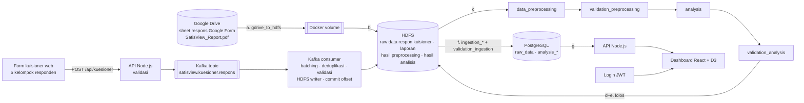

# SatisView — Kepuasan Layanan & Fasilitas PENS

Web app **landing page, form kuisioner, login, dan dashboard** kepuasan **Mahasiswa,
Dosen, Karyawan, Mitra Kerja Sama, dan Mitra Pengadaan Barang & Jasa**, lengkap dengan
pipeline data otomatis sesuai desain arsitektur
`DesignArsitekturSistem_ApacheAirflow_Final.png`:



Semua komponen berjalan di **Docker Compose**: HDFS (NameNode + DataNode), Apache
Kafka 3.9 (mode KRaft) + Kafka consumer, Apache Airflow 2.10.5, PostgreSQL 16,
API Node.js/Express, dan frontend React (Nginx).

---

## 1. Menjalankan

**Prasyarat:** Docker Engine/Desktop ≥ 24 dengan Compose v2, RAM untuk Docker ≥ 8 GB,
port `3000`, `8080`, `9870`, `5433` kosong.

```bash
cp .env.example .env          # lalu isi JWT_SECRET, akun admin, password, akses Google Drive
# Linux saja: samakan pemilik file log dengan user Anda
sed -i "s/^AIRFLOW_UID=.*/AIRFLOW_UID=$(id -u)/" .env
docker compose up -d --build  # build pertama ±5–10 menit
docker compose ps             # tunggu sampai semua "healthy"
```

Wajib diisi di `.env` sebelum menyalakan pertama kali:

* `JWT_SECRET` — string acak ≥ 32 karakter (`python -c "import secrets; print(secrets.token_urlsafe(48))"`).
* `SATISVIEW_ADMIN_USERNAME` / `SATISVIEW_ADMIN_PASSWORD` — akun admin dashboard
  pertama (password ≥ 8 karakter berisi huruf dan angka).
* Password `POSTGRES_PASSWORD`, `DASHBOARD_DB_PASSWORD`, `AUTH_DB_PASSWORD`,
  `AIRFLOW_ADMIN_PASSWORD` (alfanumerik).

**Windows (PowerShell):** pakai `Copy-Item .env.example .env`, lewati baris `sed`
(khusus Linux; biarkan `AIRFLOW_UID=50000`), lalu jalankan dua perintah `docker compose`
di atas. Docker Desktop sebaiknya memakai backend WSL 2.

**Memperbarui dari versi 1.2.0:** salin variabel baru dari `.env.example` ke `.env`
(bagian *Login pengelola* dan *Form kuisioner web*), lalu `docker compose up -d --build`.
Data lama di volume tetap dipakai; service `db-migrate` membuat tabel akun otomatis.

| Layanan | Alamat | Keterangan |
|---|---|---|
| SatisView | http://localhost:3000 | landing page, form kuisioner, login, dashboard |
| Apache Airflow | http://localhost:8080 | login `AIRFLOW_ADMIN_USER` / `AIRFLOW_ADMIN_PASSWORD` di `.env` |
| HDFS NameNode UI | http://localhost:9870 | *Utilities → Browse the file system* → `/satisview` |
| PostgreSQL | `localhost:5433` | user `POSTGRES_USER` (DBeaver/pgAdmin); port diatur `POSTGRES_HOST_PORT` |

Kafka hanya dapat diakses di jaringan Docker (`kafka:9092`), tidak dibuka ke host.

### Alamat halaman

| Halaman | Alamat | Akses |
|---|---|---|
| Landing page | `/` | publik |
| Halaman akses (pilih peran / login) | `/#/masuk` | publik |
| Form Mahasiswa | `/#/kuesioner/mahasiswa` | publik, tanpa login |
| Form Dosen | `/#/kuesioner/dosen` | publik, tanpa login |
| Form Karyawan / Tendik | `/#/kuesioner/karyawan` | publik, tanpa login |
| Form Mitra Kerja Sama | `/#/kuesioner/mitra_kerjasama` | publik, tanpa login |
| Form Mitra Pengadaan Barang & Jasa | `/#/kuesioner/mitra_pengadaan` | publik, tanpa login |
| Dashboard | `/#/dashboard/<kelompok>/<kpi\|mapping\|text>` | **hanya akun terdaftar** |

Alamat form dapat dibagikan langsung ke responden (mis. lewat QR code). Tautan
dashboard lama (`#/mahasiswa/kpi`) otomatis diarahkan ke alamat baru.

DAG dalam keadaan aktif sejak awal: begitu scheduler menyala, `gdrive_to_hdfs`
langsung berjalan lalu memicu DAG berikutnya; selanjutnya tiap 6 jam
(`SATISVIEW_SCHEDULE`). Respons form web diperiksa tiap 15 menit
(`SATISVIEW_FORM_WEB_SCHEDULE`). Jalankan manual kapan saja dengan tombol ▶ di
Airflow atau `make trigger`.

**Sumber data hanya respons asli**, dari dua jalur yang digabung per kelompok:
sheet respons Google Form di folder Drive *Data Responden* dan respons form web
SatisView. Tidak ada mode data contoh; kelompok tanpa respons menampilkan
"Belum ada respons".

## 2. Login & akun pengelola dashboard

* **Responden tidak perlu akun.** Di halaman akses mereka memilih *Akses sebagai*
  (Mahasiswa, Dosen, Karyawan / Tendik, Mitra Kerja Sama, Mitra Pengadaan) lalu
  *Mulai Kuesioner*.
* **Pengelola / Stakeholder** memilih *Pengelola / Stakeholder*, lalu masuk dengan
  username + password. Hanya akun yang terdaftar di sistem yang bisa membuka dashboard.
* Login menghasilkan **JWT** (HS256, berlaku `JWT_TTL_MINUTES`, default 8 jam) yang
  disimpan di tab browser (`sessionStorage`) — hilang saat tab ditutup. Setiap
  permintaan data dashboard dan unduh laporan wajib membawa token ini.
* Password disimpan sebagai hash **scrypt**; 5 kali salah → akun terkunci 15 menit;
  batas 20 percobaan login / 10 menit per alamat IP. Reset password atau menonaktifkan
  akun langsung membatalkan token lama (≤ 60 detik).
* Akun pertama dibuat dari `SATISVIEW_ADMIN_*` saat API pertama kali menyala (bila
  username itu belum ada). Sesudahnya `SATISVIEW_ADMIN_PASSWORD` boleh dikosongkan.

Kelola akun lewat CLI di container `backend`:

```bash
docker compose exec backend npm run pengguna -- daftar
docker compose exec backend npm run pengguna -- tambah kepala.ppm --nama "Kepala PPMPP" --peran pimpinan
docker compose exec backend npm run pengguna -- reset-password kepala.ppm
docker compose exec backend npm run pengguna -- nonaktifkan kepala.ppm
docker compose exec backend npm run pengguna -- aktifkan kepala.ppm
```

Password diketik saat diminta (tidak tampil di layar). Peran: `admin`, `pimpinan`,
`pengelola` — semuanya dapat melihat dashboard; peran tampil di navbar. Username 3–32
karakter huruf kecil/angka/`.`/`_`/`-`. Akun tersimpan di tabel `auth.pengguna`
(database `POSTGRES_DB`) yang dibuat service `db-migrate`; API memakai role khusus
`AUTH_DB_USER` yang hanya boleh membaca/menambah/mengubah tabel itu.

## 3. Form kuisioner web → Kafka → HDFS

**Isi kelima form sama persis dengan Google Form tim** (judul, deskripsi, urutan
bagian, pertanyaan, pilihan, wajib/tidak, grid, batas 3 pilihan, opsi "Yang lain",
dan percabangan Klinik pada form Mahasiswa). Isinya disimpan sekali di
**`contracts/kuesioner.json`**, dipakai bersama oleh:

* frontend — halaman form dibangun dari `GET /api/kuesioner/<kelompok>`;
* API — memvalidasi setiap jawaban sebelum dikirim ke Kafka;
* Kafka consumer — memvalidasi ulang sebelum menulis ke HDFS;
* pipeline — nama kolom = judul kolom sheet Google Form (termasuk spasi di ujung),
  sehingga kode preprocessing & analisis tim memproses respons web persis seperti
  respons Google Form. `airflow/tests/test_form_web.py` dan
  `airflow/tests/data/kolom_sheet_asli.json` menguji kesamaan kolom ini.

Kolom *Email* tidak ada di form web karena sheet respons Google Form tim juga tidak
mencatatnya. Bila Google Form diubah, ubah juga `contracts/kuesioner.json` (naikkan
`versi` bila struktur berubah) lalu jalankan pengujian.

**Pengalaman responden:** satu bagian per halaman seperti Google Form, indikator
progres, validasi langsung di tiap pertanyaan, jawaban tersimpan otomatis di perangkat
(bisa dilanjutkan setelah browser ditutup), dan bila server sedang sibuk jawaban tidak
hilang — cukup tekan *Kirim ulang*. Klik ganda / kirim ulang tidak membuat respons
ganda (`id_pengiriman` unik). Perlindungan: batas kiriman per IP
(`KUESIONER_RATE_LIMIT_PER_MINUTE`), kolom jebakan bot, ukuran maksimum 256 KB.

**Alur data:**

| Tahap (diagram) | Komponen | Keterangan |
|---|---|---|
| FORM → Kafka Topic | API `POST /api/kuesioner/<kelompok>` | jawaban divalidasi, diubah ke baris berkolom sheet, dikirim ke topik `satisview.kuesioner.respons` (3 partisi, `acks=all`) |
| batching, deduplication, data validation | service `kafka-consumer` | kumpulkan s.d. `KAFKA_BATCH_MAKS` pesan atau `KAFKA_BATCH_TUNGGU_DETIK` detik; `id_respons` yang sudah ada di HDFS dilewati; pesan tak valid → `/satisview/raw/form_web/_ditolak/` |
| HDFS_writer, data_validation | `kafka-consumer` | tulis `/satisview/raw/form_web/<kelompok>/batch_p<partisi>_o<offset>-<offset>_<hash>.csv`, lalu dibaca ulang dan dicocokkan |
| committed_offset | `kafka-consumer` | offset di-commit **hanya setelah** file terverifikasi; bila gagal, batch diulang (tanpa duplikat berkat deduplikasi) |
| HDFS → pipeline | DAG `form_web_to_pipeline` (tiap 15 menit) | bila ada batch baru, memicu `preprocessing_analysis` dan `ingestion_raw_data_kuisioner` |

Respons web biasanya tampil di dashboard ±15–20 menit setelah dikirim. Tabel
`raw_data.kuisioner_<kelompok>` memiliki kolom **`Sumber`** (`Google Form` /
`Form Web SatisView`).

## 4. Akses Google Drive

Folder default (bisa diubah di `.env`):
`GDRIVE_DATA_FOLDER_ID=1eGAoqvFkWy0qmNz_hFyMgY8kzQaGntJ7` (Data Responden) dan
`GDRIVE_REPORT_FOLDER_ID=1USXnj85DRgiZ84qoBUAIWAhg7M6VS6RG` (laporan).
Pipeline mengunduh **semua** sheet di folder itu setiap kali DAG `gdrive_to_hdfs`
berjalan (default tiap 6 jam), jadi respons baru otomatis ikut terolah. Cara akses
dipilih otomatis, berurutan:

1. **Service account (disarankan)** — buat service account di Google Cloud, aktifkan
   *Google Drive API*, unduh kunci JSON ke `secrets/service-account.json`, lalu
   bagikan kedua folder ke email service account sebagai *Viewer* (detail:
   `secrets/README.md`). Folder tidak perlu publik.
2. **API key** — isi `GDRIVE_API_KEY` (Google Drive API v3). Folder & file harus
   dibagikan *Siapa saja yang memiliki link*.
3. **Publik tanpa kredensial (default)** — memakai `gdown`. Folder harus *Siapa saja
   yang memiliki link*. Paling mudah, tetapi bergantung pada halaman web Drive.

File sheet dikenali dari namanya: mengandung `Mahasiswa`, `Dosen`,
`Karyawan`/`Tendik`, `Kerja sama`, atau `Pengadaan` (lihat
`airflow/include/satisview/respondents.py`). Google Sheets diekspor sebagai **XLSX**
(arsip asli, sesuai diagram) dan **CSV** (isi sel apa adanya). Laporan dicari dengan
nama `SatisView_Report.pdf`; selama belum diunggah, tombol **Report** menampilkan
pesan "Laporan belum tersedia".

## 5. Alur pipeline (pemetaan ke desain arsitektur)

| Narasi | DAG / task Airflow | Hasil |
|---|---|---|
| (a) Drive → docker volume | `gdrive_to_hdfs.extract_gdrive_to_volume` | volume `satisview_data:/opt/satisview/data/landing` |
| (b) volume → HDFS | `gdrive_to_hdfs.load_volume_to_hdfs` | `/satisview/raw/xlsx/`, `/satisview/raw/csv/`, `/satisview/report/` |
| (b') form web → HDFS | Kafka consumer (bagian 3) + `form_web_to_pipeline` | `/satisview/raw/form_web/<responden>/` |
| (c) HDFS → preprocessing (kode tim) | `preprocessing_analysis.<responden>.data_preprocessing` | sheet Google Form + respons form web digabung, lalu 7–8 CSV keluaran notebook preprocessing tim + `meta` |
| (d) validasi preprocessing | `…validation_preprocessing` | lolos → `/satisview/preprocessed/<responden>/` |
| (e) analisis (kode tim) + validasi | `…analysis` → `…validation_analysis` | lolos → `/satisview/analysis/<responden>/*.csv` (13 file) |
| (f) HDFS → PostgreSQL | `ingestion_raw_data_kuisioner`, `ingestion_analysis_result` (`ingest_<responden>`) | DB `raw_data`, `analysis_<responden>` |
| (f') validation_ingestion | `…validation_ingestion_<responden>` | jumlah baris & kolom tabel = sumber, tanpa kolom data pribadi, tanpa tabel liar; laporan `/satisview/validation/<responden>/validation_ingestion_*.json` |
| (g) PostgreSQL → dashboard | API `backend` → `frontend` (login JWT) | http://localhost:3000/#/dashboard |

* Tiap kelompok responden punya jalur sendiri (TaskGroup/task), jadi kegagalan satu
  kelompok tidak menghentikan yang lain. Kelompok tanpa data di-*skip*.
* **Validasi gagal = data lama tetap dipakai.** CSV hanya disimpan ke HDFS bila lolos;
  laporan validasi (JSON) selalu disimpan di `/satisview/validation/<responden>/` dan
  tampil di log task.
* Sheet kosong tetap diproses: validasi berstatus `kosong`, tabel dibuat tanpa baris,
  dashboard menampilkan "Belum ada respons".

### PostgreSQL: satu file = satu tabel

| Database | Tabel (= nama file CSV) |
|---|---|
| `raw_data` | `kuisioner_mahasiswa`, `kuisioner_dosen`, `kuisioner_karyawan`, `kuisioner_mitra_kerjasama`, `kuisioner_mitra_pengadaan` |
| `analysis_<responden>` (5 database) | `kpi_ringkasan_<r>`, `kpi_aspek_<r>`, `kpi_item_<r>`, `prioritas_aspek_<r>`, `frekuensi_aspek_<r>`, `teks_bersih_<r>`, `aspek_komentar_<r>`, `kata_teratas_<r>`, `mds_titik_aspek_<r>`, `mds_titik_aspek_3d_<r>`, `mds_responden_<r>`, `mds_vektor_aspek_<r>`, `mds_stress_<r>` |
| `POSTGRES_DB` (default `satisview`) | `auth.pengguna` — akun pengelola dashboard |

`<r>` = `mahasiswa`, `dosen`, `karyawan`, `mitra_kerjasama`, `mitra_pengadaan`
(mis. `prioritas_aspek_mahasiswa` — nama yang sama dengan file keluaran notebook tim).
Hasil preprocessing (`likert_mahasiswa_utama_clean.csv`, `skor_aspek_mahasiswa.csv`, …)
disimpan di HDFS `/satisview/preprocessed/<responden>/` sebagai arsip tahap (c)–(d).

Kolom dan isi sel sama seperti file; tanpa relasi atau tabel master. Kolom data
pribadi (Nomor Gopay, Nama Instansi, Nama Instansi Mitra) **tidak dimuat** ke
PostgreSQL — arsip lengkapnya hanya di HDFS. Batas PostgreSQL **63 byte** untuk nama
kolom: judul pertanyaan yang lebih panjang dipotong dan diberi kode hash pendek
(`…kejela~00babe`), sedangkan judul lengkapnya disimpan sebagai `COMMENT` kolom
(`\d+ kuisioner_dosen` di psql). Tabel diganti secara atomik setiap ingestion.

## 6. Preprocessing & analisis (kode tim)

Kode dari **`Preprocessing&Analysis.zip`** sudah menjadi bagian pipeline:

* Notebook asli tim disimpan apa adanya di folder **`analisis/`**.
* Isinya di-*port* ke modul Python di **`airflow/include/satisview/tim/`** dengan nama
  fungsi, rumus, parameter (bobot ⅓, `random_state=42`, `n_init`, pembulatan) dan nama
  file CSV yang sama. Yang diubah hanya path `data/raw|clean|analytics` (diganti file di
  docker volume/HDFS), konstanta per kelompok dipindah ke `tim/konfigurasi.py`, dan grafik
  matplotlib tidak dibuat (visualisasi ada di dashboard D3).

| Notebook tim (`analisis/`) | Modul (`satisview/tim/`) | Keluaran |
|---|---|---|
| `preprocssing-mahasiswa-finalpakeygini.ipynb` | `preprocessing.py` | `likert_<r>_utama_clean`, `likert_mahasiswa_klinik_clean`, `teks_<r>_clean`, `kategori_<r>_clean`, `kamus_item_aspek_<r>`, `skor_aspek_<r>`, `ringkasan_item_<r>`, `ringkasan_aspek_<r>` |
| `text-analytics-mahasiswa.ipynb` | `text_analytics.py` | `teks_bersih_<r>`, `aspek_komentar_<r>`, `frekuensi_aspek_<r>`, `kata_teratas_<r>` |
| `priority-analysis-mahasiswa.ipynb` | `priority_analysis.py` | `prioritas_aspek_<r>` |
| `mds-mahasiswa.ipynb` | `mds.py` | `mds_responden_<r>`, `mds_vektor_aspek_<r>`, `mds_titik_aspek_<r>`, `mds_stress_<r>` |

**Hasilnya identik dengan notebook.** `airflow/tests/test_notebook_tim.py` menjalankan
keempat notebook asli dan pipeline pada data yang sama, lalu membandingkan ke-16 file
CSV-nya (semua sama persis).

### 6.1 Lima kelompok responden
Notebook tim ditulis untuk Mahasiswa. Agar kode yang sama berjalan untuk semua kelompok,
konstanta tiap notebook (`KOLOM_PII`, `KOLOM_TEKS`, `KOLOM_KATEGORI`, `ASPEK_KATA_KUNCI`,
`KATA_PILIHAN`, …) ada di **`tim/konfigurasi.py`**:

* **Mahasiswa** — disalin persis dari notebook (termasuk bagian Klinik bersyarat).
* **Dosen & Karyawan** — judul kolom dari Google Form; kamus kata kunci aspek dibuat
  dengan gaya kamus tim. Jawaban berupa label ("Sangat Puas") dipetakan ke skor 1–4.
* **Mitra Kerja Sama & Mitra Pengadaan** — struktur mengikuti Google Form asli: grid
  `Judul [butir]` berskala 4 label ("Tidak puas … Sangat puas", "Tidak butuh … Sangat
  butuh", "Tidak relevan … Sangat relevan"; tingkat terendah = 1), profil mitra, teks
  harapan/evaluasi, dan pilihan prioritas maksimal 3. Data pribadi (Nama Instansi /
  Nama Instansi Mitra) tidak ikut dianalisis. Pilihan prioritas Mitra Pengadaan
  dipetakan ke aspek grid di `KATA_PILIHAN` (mis. *Kecepatan pelayanan* → Proses Kerja
  Sama); periksa dan sesuaikan bila tim memakai pemetaan lain. Peran kolom juga tetap
  dapat dideteksi otomatis untuk sheet lama (pertanyaan tunggal, skala 1–5).

Perluasan kecil yang tidak mengubah hasil Mahasiswa ditandai `# [perluasan]` di kode,
mis. pemetaan label tanpa angka, aspek dari judul grid `Aspek [Pertanyaan]`, dan
aspek tanpa jawaban di suatu segmen tidak dijadikan "paling tidak puas" oleh `fillna(0)`.

### 6.2 Analisis per segmen & tabel KPI
* Baris `segmen = "Semua"` = keluaran notebook untuk seluruh responden. Fungsi yang sama
  juga dijalankan per Program Studi / Departemen / Unit Kerja / jenis mitra agar filter
  segmen di dashboard berfungsi. Kolom asli notebook selalu di depan, kolom tambahan
  (`segmen`, `id_komentar`, …) di belakang.
* **KPI**: Indeks = `rata_rata` (ringkasan tim) ÷ skor maksimum skala (4, atau 5 untuk form
  berskala 1–5) × 100; Indeks Total =
  rerata indeks aspek; mutu A/B/C/D mengikuti IKM PermenPANRB 14/2017.
* **MDS**: peta responden & vektor aspek dihitung untuk seluruh responden; peta aspek
  2D (dan 3D, perluasan untuk "Visualisasi 3D") juga per segmen bila responden lengkap ≥
  `SATISVIEW_MIN_RESPONDEN_MDS` (default 10). Peta segmen diputar (Procrustes) agar
  searah dengan peta "Semua"; jarak antar titik tidak berubah.
* Versi library dikunci di `airflow/requirements.txt` (scikit-learn 1.9.1, Sastrawi
  1.0.1) karena koordinat MDS dapat sedikit berbeda antarversi scikit-learn.

### 6.3 Validasi
* **validation_preprocessing** — kontrak `contracts/data_contract.json` (kolom wajib,
  tipe, rentang skor, kunci unik), `cek_konversi` notebook (gagal bila > 1% jawaban tidak
  terkonversi, `SATISVIEW_MAX_GAGAL_KONVERSI`), aspek `TIDAK TERDETEKSI`, kolom data
  pribadi tidak boleh ikut, kamus ↔ skor aspek ↔ ringkasan konsisten.
* **validation_analysis** — kontrak 13 tabel, baris "Semua" ada dan jumlah respondennya
  sama, KPI aspek "Semua" = `ringkasan_aspek` tim, ranking 1..n per segmen; peringatan
  untuk komentar tanpa aspek, pilihan prioritas tak terpetakan, MDS dilewati, dan
  Stress-1 "kurang baik".
* **validation_ingestion** — setelah dimuat, isi PostgreSQL dicocokkan dengan sumbernya:
  jumlah baris (per sumber Google Form / form web) dan kolom sama, tidak ada kolom data
  pribadi, setiap CSV analisis punya tabel dengan baris & kolom yang sama, dan tidak ada
  tabel yang tidak dikenal.

### 6.4 Mengubah kode/konfigurasi
* Ubah langsung `airflow/include/satisview/tim/*.py` (folder `include` ter-mount ke
  container; perubahan terbaca pada run berikutnya), mis. menambah kata kunci aspek atau
  memperbaiki kamus slang. Jalankan `pytest airflow/tests -q` sesudahnya.
* Untuk mengganti/menambah langkah tanpa menyentuh kode tim, pakai modul alternatif di
  `airflow/include/satisview/custom/` (lihat README di folder itu) dan set
  `SATISVIEW_PREPROCESSING_MODULE` / `SATISVIEW_ANALYSIS_MODULE` di `.env`.

## 7. Frontend

React 19 + Vite, **TailwindCSS v4**, JavaScript, dan **D3.js v7** untuk seluruh grafik.
Satu aplikasi berisi empat bagian:

* **Landing page** (dari prototipe `satisviewww.html`) — navbar melayang, hero foto
  gedung PENS, karusel *Fitur utama* (geser otomatis, berhenti saat disentuh/fokus),
  *Tentang SatisView*, *Alur* respons → insight (Google Forms / Form Web SatisView,
  Apache Kafka, Hadoop HDFS, Apache Airflow, PostgreSQL, React, JWT), dan *Pengguna*.
* **Halaman akses / login** — *Welcome back!*, pilihan *Akses sebagai* (5 kelompok
  responden + Pengelola / Stakeholder). Responden langsung diarahkan ke formnya; pengelola
  mengisi username & password lalu masuk ke dashboard.
* **Form kuisioner** — banner foto bergradasi biru, daftar bagian & progres di samping,
  kartu pertanyaan putih membulat, pilihan berbentuk kartu, grid dalam segmen tombol,
  tombol biru (*Berikutnya*) dan kuning (*Kirim*), halaman terima kasih.
* **Dashboard** —
  * **KPI** — Indeks Total & mutu, aspek indeks tertinggi/terendah, *Layanan Unggulan*
    dan *Layanan Prioritas Perbaikan* (ranking **skor prioritas** tim), panel *Aspek
    Kuisioner*, serta kuadran % dipilih × skor kepuasan.
  * **Mapping Analytics** — peta persepsi **MDS** 2D dan **3D** serta *Peta Responden*;
    nilai Stress-1, filter aspek & segmen, tabel koordinat.
  * **Text Analytics** — *Top 5 Topik Komentar*, kata yang paling sering muncul,
    daftar komentar per aspek, filter segmen, pencarian kata.
  * Navbar memuat nama & peran pengguna serta tombol **Keluar**; sesi yang kedaluwarsa
    otomatis kembali ke halaman login lalu kembali ke tampilan semula setelah masuk.

### Responsif
| Layar | Lebar | Perilaku |
|---|---|---|
| Desktop & laptop | ≥ 1024 px | menu analisis di navbar; form dengan panel progres di kiri |
| Tablet | 640–1023 px | menu analisis pindah ke **sidebar** (tombol ☰); progres form di atas kartu |
| Ponsel | < 640 px | sidebar yang sama; pilihan form satu kolom, grid jawaban 2 × 2; tombol Report berupa ikon; tanpa gulir horizontal |

### Penerapan 7 prinsip desain
| Prinsip | Penerapan |
|---|---|
| **Balance** | Kolom kiri–kanan KPI sama tinggi; form: panel progres 1 : 3 kartu pertanyaan; halaman login dua panel (form – foto). |
| **Color** | Nuansa logo PENS: biru `#14487A` (struktur, tombol utama), kuning `#F3C903` (aksen, tombol *Kirim*, progres), putih (kartu). Merah hanya untuk galat dan selalu disertai teks. |
| **Spacing** | Skala 4/8 px: jarak antar kartu 24–32 px, padding kartu 20–24 px, teks dibatasi ± 80 karakter per baris. |
| **Consistency** | Satu pola kartu, semua tombol & chip berbentuk pil, satu gaya ikon garis, format angka Indonesia, komponen pilihan yang sama di kelima form. |
| **Contrast** | Semua teks ≥ 4,5 : 1; pilihan aktif = isi penuh; cincin fokus keyboard jelas. |
| **Aesthetics** | Foto gedung PENS bergradasi biru, garis tiga warna khas templat PENS, logo skrip "Satisview", font Poppins + DM Serif Display (di-bundle lokal). |
| **Feedback** | Hover/aktif di setiap tombol & grafik, skeleton saat memuat, pesan galat di pertanyaan yang belum lengkap (fokus otomatis), status "tersimpan otomatis", *Kirim ulang* saat server sibuk, toast unduh laporan. Gerakan dimatikan bila *prefers-reduced-motion*. |

## 8. API

| Endpoint | Akses | Isi |
|---|---|---|
| `GET /api/health`, `GET /api/health/live` | publik | status API, PostgreSQL, HDFS |
| `POST /api/auth/masuk` | publik | `{username, password}` → `{token, kedaluwarsa, pengguna}` |
| `GET /api/auth/saya`, `POST /api/auth/keluar` | token | profil pengguna / keluar |
| `GET /api/kuesioner`, `GET /api/kuesioner/:kelompok` | publik | daftar form / isi form (tanpa nama kolom internal) |
| `POST /api/kuesioner/:kelompok` | publik | `{id_pengiriman, versi, jawaban}` → 202 diterima · 422 jawaban belum lengkap · 409 versi form berubah · 429 terlalu sering · 503 server sibuk |
| `GET /api/groups` | token | status data tiap kelompok responden |
| `GET /api/groups/:grup/segments` | token | daftar segmen + jumlah responden |
| `GET /api/groups/:grup/kpi?segmen=` | token | ringkasan, indeks aspek & butir, ranking prioritas tim |
| `GET /api/groups/:grup/mapping?segmen=` | token | titik MDS aspek 2D/3D, Stress-1, peta responden + vektor aspek |
| `GET /api/groups/:grup/topics?segmen=` | token | frekuensi aspek di komentar + kata teratas |
| `GET /api/groups/:grup/comments?segmen=&topik=&q=&limit=&offset=` | token | komentar (filter aspek, `topik=__tanpa_aspek__`, pencarian) |
| `GET /api/report/status`, `GET /api/report` | token | status & unduhan `SatisView_Report.pdf` dari HDFS |

"Token" = header `Authorization: Bearer <JWT>`. Data dashboard dibaca dengan role
PostgreSQL baca-saja `DASHBOARD_DB_USER` dan API tidak pernah menampilkan isi tabel raw
(yang bisa memuat data pribadi) — hanya jumlah barisnya.

## 9. Struktur proyek

```
satisview/
├── docker-compose.yml        # seluruh stack (HDFS, Kafka, Airflow, PostgreSQL, API, web)
├── .env.example              # konfigurasi (salin ke .env)
├── analisis/                 # notebook asli tim (Preprocessing&Analysis.zip)
├── contracts/
│   ├── kuesioner.json        # isi 5 form kuisioner (sama dengan Google Form) + nama kolom sheet
│   └── data_contract.json    # kontrak file CSV preprocessing & analisis
├── hadoop/hadoop.env         # konfigurasi HDFS (WebHDFS aktif)
├── postgres/init/            # membuat 6 database + role baca-saja
├── secrets/                  # service-account.json (tidak di-commit)
├── airflow/
│   ├── Dockerfile, requirements.txt
│   ├── dags/                 # 5 DAG: gdrive_to_hdfs, form_web_to_pipeline,
│   │                         #   preprocessing_analysis, ingestion_raw_data_kuisioner, ingestion_analysis_result
│   ├── include/satisview/
│   │   ├── tim/              # kode preprocessing & analisis tim (port notebook) + konfigurasi
│   │   ├── form_web.py       # membaca batch form web dari HDFS & menggabungkannya dengan sheet Google Form
│   │   ├── preprocessing.py, analysis.py   # adapter pipeline -> kode tim (per segmen + KPI)
│   │   ├── validation.py, ingestion.py, hdfs.py, gdrive.py, pipeline.py
│   │   └── custom/           # tempat modul alternatif (opsional)
│   └── tests/                # pytest (+ WebHDFS & Drive tiruan, uji kesamaan dengan notebook)
├── consumer/                 # Kafka consumer (Python): batching, deduplikasi, validasi, HDFS writer
├── backend/                  # API Node.js/Express
│   └── src/auth (login JWT), src/kuesioner (form -> Kafka), src/cli (migrasi & akun)
├── frontend/                 # React + Tailwind + D3
│   └── src/pages (Landing, Login, Kuesioner, Dashboard), src/components, src/charts, src/views
└── e2e/                      # uji end-to-end di browser (Playwright)
```

## 10. Pengujian

```bash
# Pipeline (Python 3.11): kode tim, validasi, kontrak, form web, DAG, kesamaan dengan notebook
python -m venv .venv && . .venv/bin/activate
pip install "apache-airflow==2.10.5" -r airflow/requirements.txt pytest \
  --constraint https://raw.githubusercontent.com/apache/airflow/constraints-2.10.5/constraints-3.11.txt
pytest airflow/tests -q
# + uji integrasi PostgreSQL (mis. memakai container stack ini)
SATISVIEW_TEST_PG_HOST=localhost SATISVIEW_TEST_PG_PORT=5433 \
SATISVIEW_TEST_PG_PASSWORD=<POSTGRES_PASSWORD> pytest airflow/tests -q
# + uji dengan DATA ASLI: unduh folder Drive "Data Responden" (klik kanan -> Download),
#   ekstrak, lalu arahkan ke foldernya (data asli tidak disimpan di repositori)
SATISVIEW_DATA_ASLI="/path/ke/Data Responden" pytest airflow/tests/test_data_asli.py -q

# Kafka consumer (Python 3.11/3.12)
pip install -r consumer/requirements-dev.txt
pytest consumer/tests -q
# + uji dengan broker Kafka sungguhan (topik dibuat otomatis oleh tes)
SATISVIEW_TEST_KAFKA=localhost:9092 pytest consumer/tests -q

# API (login, form kuisioner, dashboard)
cd backend && npm install && npm test
# + uji dengan PostgreSQL: data dashboard hasil pipeline (baca saja) & tabel akun di
#   database uji tersendiri SATISVIEW_TEST_DB (default satisview_uji; akun asli tidak disentuh)
PGHOST=localhost PGPORT=5433 PGUSER=satisview PGPASSWORD=<POSTGRES_PASSWORD> \
POSTGRES_USER=satisview POSTGRES_PASSWORD=<POSTGRES_PASSWORD> TEST_WITH_DB=1 npm test
# Frontend
cd frontend && npm install && npm run lint && npm run build
npm run dev                    # mode pengembangan (API di localhost:4000)

# End-to-end di browser terhadap stack yang sedang berjalan (docker compose up)
cd e2e && npm install && npx playwright install chromium
SATISVIEW_USERNAME=admin SATISVIEW_PASSWORD=<password admin> npm test
```

Uji end-to-end memeriksa landing page, halaman akses, penjaga dashboard, login/logout,
pengisian kelima form sampai halaman terima kasih (termasuk jalur Klinik "Tidak"),
pemulihan draf, dan tampilan ponsel/tablet tanpa gulir horizontal; tangkapan layar
tersimpan di `e2e/hasil/`. Secara bawaan pengiriman form **dicegat** di browser sehingga
tidak ada data uji yang masuk. `E2E_KIRIM=1` mengirim respons sungguhan sampai Kafka →
HDFS → dashboard — pakai **hanya di stack uji**, karena respons uji ikut terhitung.

**Uji ketahanan manual:** `docker compose stop kafka`, isi dan kirim satu form → muncul
"Respons belum terkirim… Jawaban Anda tetap tersimpan di perangkat ini"; lalu
`docker compose start kafka`, tekan **Kirim ulang** → halaman terima kasih, dan
`make logs-form` menunjukkan batch tertulis ke HDFS.

## 11. Pemecahan masalah

| Gejala | Solusi |
|---|---|
| `Bind for 127.0.0.1:5433 failed: port is already allocated` | Port dipakai PostgreSQL lain di komputer Anda. Ubah `POSTGRES_HOST_PORT` di `.env` (mis. `55433`); port di dalam container tetap 5432. |
| Login admin: "Username atau password salah" | Akun admin hanya dibuat saat API pertama menyala dengan `SATISVIEW_ADMIN_*` terisi. Buat lewat `docker compose exec backend npm run pengguna -- tambah admin --nama "Administrator" --peran admin`; daftar akun: `npm run pengguna -- daftar`. |
| "Akun terkunci sementara" | 5 kali salah password; tunggu 15 menit atau `npm run pengguna -- reset-password <username>`. |
| Semua orang ter-logout setiap API restart | `JWT_SECRET` kosong/< 32 karakter (ada peringatan di `docker compose logs backend`). Isi lalu `docker compose up -d backend`. |
| Form: "Respons belum dapat diterima karena layanan sedang sibuk" | Kafka belum siap/mati. Cek `docker compose ps kafka kafka-init kafka-consumer` dan `docker compose logs kafka`. Jawaban responden tetap tersimpan; minta tekan *Kirim ulang*. |
| Respons form web tidak muncul di dashboard | `make logs-form` (API & consumer), cek HDFS `/satisview/raw/form_web/<kelompok>/` dan `_ditolak/`, lalu status DAG `form_web_to_pipeline` di Airflow. |
| Banyak responden di Wi-Fi kampus mendapat "terlalu sering mengirim" | Naikkan `KUESIONER_RATE_LIMIT_PER_MINUTE`. Bila server di belakang reverse proxy lain (VPS), set `TRUST_PROXY_HOPS` (bagian `.env`). |
| Isi Google Form diubah | Samakan `contracts/kuesioner.json` (dan `airflow/tests/data/kolom_sheet_asli.json`), lalu jalankan pengujian; form web memuat versi baru otomatis. |
| Task gagal `HDFS belum siap / safe mode` | Normal saat start; task otomatis mengulang. Cek `docker compose logs namenode`. |
| `Tidak ada satu pun sheet kuisioner yang berhasil diambil` | Folder belum dapat dibaca tanpa kredensial: bagikan folder *Siapa saja yang memiliki link* atau pakai service account/API key (bagian 4). Pesan rinci ada di log task `extract_gdrive_to_volume`. |
| Linux: `Permission denied` pada log Airflow | Set `AIRFLOW_UID=$(id -u)` di `.env`, lalu `docker compose up -d`. |
| Mac Apple Silicon lambat di HDFS | Image Hadoop hanya amd64 (berjalan lewat emulasi); aktifkan *Rosetta* di Docker Desktop. |
| Ganti password PostgreSQL setelah pernah berjalan | Password tersimpan di volume; `docker compose down -v` (hapus data) atau ubah lewat `ALTER ROLE`. Gunakan password alfanumerik. |
| Dashboard "Data belum tersedia" | Pipeline belum selesai/berhasil — lihat status DAG di Airflow. |
| `validation_preprocessing` gagal: "jawaban gagal dikonversi" | Label jawaban form tidak dikenal; tambahkan ke `MAPPING_LIKERT_UMUM` di `tim/konfigurasi.py`. Contoh label ada di laporan `/satisview/validation/<responden>/`. |
| Peringatan "komentar tanpa aspek terdeteksi" | Lengkapi `aspek_kata_kunci` kelompok tsb. di `tim/konfigurasi.py` (komentarnya tampil di topik "Aspek tidak terdeteksi"). |
| Peta MDS segmen "belum dapat dihitung" | Responden lengkap segmen < `SATISVIEW_MIN_RESPONDEN_MDS` (default 10); posisi respondennya tetap terlihat di *Peta Responden*. |
| Mulai dari nol | `docker compose down -v` lalu `docker compose up -d --build`. |

## 12. Riwayat perubahan

* **1.3.0** — Arsitektur baru `DesignArsitekturSistem_ApacheAirflow_Final.png`:
  * **Landing page & halaman login** dari prototipe `satisviewww.html` dalam React.
  * **Login JWT** untuk dashboard: akun di PostgreSQL (`auth.pengguna`, hash scrypt,
    penguncian akun), CLI kelola akun, service `db-migrate`.
  * **Form kuisioner web** untuk 5 kelompok responden, isinya sama persis dengan Google
    Form tim (`contracts/kuesioner.json`), dengan draf otomatis & kirim ulang.
  * **Apache Kafka** (KRaft) + **Kafka consumer** (batching, deduplikasi, validasi,
    HDFS writer, commit offset setelah file terverifikasi); DAG baru
    `form_web_to_pipeline`; respons Google Form dan form web digabung dengan kolom
    `Sumber`.
  * **validation_ingestion** di kedua DAG ingestion.
  * Struktur asli form Mitra Kerja Sama & Mitra Pengadaan (grid berlabel) didukung
    preprocessing; skala "Tidak puas" Mitra = tingkat terendah.
  * Uji end-to-end browser (`e2e/`).
* **1.2.0** — Hanya data respons asli dari folder Drive *Data Responden* (mode data
  sintetis dihapus dari aplikasi; data sintetis kini khusus tes). Sheet Mitra dengan
  pertanyaan tunggal atau skala 1–5 dikenali otomatis; komponen Mitra Kerja Sama dari
  sheet *ItemKuisioner*. Kolom data pribadi (mis. Nomor Gopay) tidak lagi dimuat ke
  PostgreSQL. Tampilan baru bernuansa biru–kuning–putih PENS mengikuti referensi
  *SatisView Dashboard.html*, responsif desktop–ponsel dengan menu analisis yang pindah ke
  sidebar di layar < 1024 px.
* **1.1.0** — Kode `Preprocessing&Analysis.zip` dipasang sebagai tahap preprocessing &
  analisis (port notebook di `airflow/include/satisview/tim/`, notebook asli di
  `analisis/`, hasil identik dengan notebook). Kontrak data baru
  `contracts/data_contract.json` (8 file preprocessing + 13 tabel analisis), tabel
  PostgreSQL mengikuti nama file tim (`prioritas_aspek_mahasiswa`, …), dashboard
  menampilkan skor prioritas, kuadran prioritas, peta MDS 2D/3D + peta responden, dan
  frekuensi aspek komentar. Image Airflow ditandai `2.10.5-satisview1.1.0` (menambah
  Sastrawi & scikit-learn), jadi `docker compose up -d --build` membangunnya ulang.
* **1.0.0** — Rilis awal: arsitektur Google Drive → Airflow → HDFS → PostgreSQL →
  dashboard dengan preprocessing & analisis bawaan.

---
© SatisView Team · Politeknik Elektronika Negeri Surabaya
