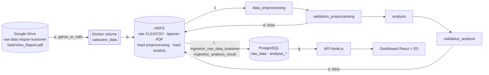

# SatisView — Dashboard Kepuasan Layanan & Fasilitas PENS

Web app dashboard kepuasan **Mahasiswa, Dosen, Karyawan, Mitra Kerja Sama, dan Mitra
Pengadaan**, lengkap dengan pipeline data otomatis sesuai desain arsitektur
`DesignArsitekturSistem_ApacheAirflow.drawio.png`:



Semua komponen berjalan di **Docker Compose**: HDFS (NameNode + DataNode), Apache
Airflow 2.10.5, PostgreSQL 16, API Node.js/Express, dan frontend React (Nginx).

---

## 1. Menjalankan

**Prasyarat:** Docker Engine/Desktop ≥ 24 dengan Compose v2, RAM untuk Docker ≥ 6 GB
(disarankan 8 GB), port `3000`, `8080`, `9870`, `5433` kosong.

```bash
cp .env.example .env          # lalu sesuaikan password & akses Google Drive (bagian 2)
# Linux saja: samakan pemilik file log dengan user Anda
sed -i "s/^AIRFLOW_UID=.*/AIRFLOW_UID=$(id -u)/" .env
docker compose up -d --build  # build pertama ±5–10 menit
docker compose ps             # tunggu sampai semua "healthy"
```

**Windows (PowerShell):** pakai `Copy-Item .env.example .env`, lewati baris `sed`
(khusus Linux; biarkan `AIRFLOW_UID=50000`), lalu jalankan dua perintah `docker compose`
di atas. Docker Desktop sebaiknya memakai backend WSL 2.

| Layanan | Alamat | Keterangan |
|---|---|---|
| Dashboard SatisView | http://localhost:3000 | aplikasi utama |
| Apache Airflow | http://localhost:8080 | login `AIRFLOW_ADMIN_USER` / `AIRFLOW_ADMIN_PASSWORD` di `.env` |
| HDFS NameNode UI | http://localhost:9870 | *Utilities → Browse the file system* → `/satisview` |
| PostgreSQL | `localhost:5433` | user `POSTGRES_USER` (DBeaver/pgAdmin) |

DAG dalam keadaan aktif sejak awal: begitu scheduler menyala, `gdrive_to_hdfs`
langsung berjalan lalu memicu DAG berikutnya; selanjutnya tiap 6 jam
(`SATISVIEW_SCHEDULE`). Jalankan manual kapan saja dengan tombol ▶ di Airflow atau
`make trigger`. Proses awal sampai dashboard terisi ±2–5 menit (HDFS perlu keluar
dari *safe mode* dulu).

**Sumber data hanya respons asli.** Dashboard selalu menampilkan hasil olahan sheet
respons Google Form di folder Drive *Data Responden*; tidak ada mode data contoh. Saat
ini folder berisi respons Mahasiswa, Mitra Kerja Sama, dan Mitra Pengadaan Barang &
Jasa; sheet Dosen dan Karyawan baru berisi judul kolom, sehingga halaman keduanya
menampilkan "Belum ada respons" sampai kuisionernya diisi.

## 2. Akses Google Drive

Folder default (bisa diubah di `.env`):
`GDRIVE_DATA_FOLDER_ID=1eGAoqvFkWy0qmNz_hFyMgY8kzQaGntJ7` (Data Responden) dan
`GDRIVE_REPORT_FOLDER_ID=1USXnj85DRgiZ84qoBUAIWAhg7M6VS6RG` (laporan).
Pipeline mengunduh **semua** sheet di folder itu setiap kali DAG `gdrive_to_hdfs`
berjalan (default tiap 6 jam), jadi respons baru otomatis ikut terolah. Cara akses
dipilih otomatis, berurutan:

1. **Service account (disarankan)** — buat service account di Google Cloud, aktifkan
   *Google Drive API*, unduh kunci JSON ke `secrets/service-account.json`, lalu
   bagikan kedua folder ke email service account sebagai *Viewer* (detail:
   `secrets/README.md`). Folder tidak perlu publik.
2. **API key** — isi `GDRIVE_API_KEY` (Google Drive API v3). Folder & file harus
   dibagikan *Siapa saja yang memiliki link*.
3. **Publik tanpa kredensial (default)** — memakai `gdown`. Folder harus *Siapa saja
   yang memiliki link*. Paling mudah, tetapi bergantung pada halaman web Drive.

File sheet dikenali dari namanya: mengandung `Mahasiswa`, `Dosen`,
`Karyawan`/`Tendik`, `Kerja sama`, atau `Pengadaan` (lihat
`airflow/include/satisview/respondents.py`). Google Sheets diekspor sebagai **XLSX**
(arsip asli, sesuai diagram) dan **CSV** (isi sel apa adanya). Laporan dicari dengan
nama `SatisView_Report.pdf`; selama belum diunggah, tombol **Report** menampilkan
pesan "Laporan belum tersedia".

## 3. Alur pipeline (pemetaan ke desain arsitektur)

| Narasi | DAG / task Airflow | Hasil |
|---|---|---|
| (a) Drive → docker volume | `gdrive_to_hdfs.extract_gdrive_to_volume` | volume `satisview_data:/opt/satisview/data/landing` |
| (b) volume → HDFS | `gdrive_to_hdfs.load_volume_to_hdfs` | `/satisview/raw/xlsx/`, `/satisview/raw/csv/`, `/satisview/report/` |
| (c) HDFS → preprocessing (kode tim) | `preprocessing_analysis.<responden>.data_preprocessing` | 7–8 CSV keluaran notebook preprocessing tim + `meta` |
| (d) validasi preprocessing | `…validation_preprocessing` | lolos → `/satisview/preprocessed/<responden>/` |
| (e) analisis (kode tim) + validasi | `…analysis` → `…validation_analysis` | lolos → `/satisview/analysis/<responden>/*.csv` (13 file) |
| (f) HDFS → PostgreSQL | `ingestion_raw_data_kuisioner`, `ingestion_analysis_result` | DB `raw_data`, `analysis_<responden>` |
| (g) PostgreSQL → dashboard | API `backend` → `frontend` | http://localhost:3000 |

* Tiap kelompok responden punya jalur sendiri (TaskGroup), jadi kegagalan satu
  kelompok tidak menghentikan yang lain. Kelompok tanpa data di-*skip*.
* **Validasi gagal = data lama tetap dipakai.** CSV hanya disimpan ke HDFS bila lolos;
  laporan validasi (JSON) selalu disimpan di `/satisview/validation/<responden>/` dan
  tampil di log task.
* Sheet kosong (Dosen & Karyawan saat ini) tetap diproses: validasi berstatus
  `kosong`, tabel dibuat tanpa baris, dashboard menampilkan "Belum ada respons".

### PostgreSQL: satu file = satu tabel

| Database | Tabel (= nama file CSV) |
|---|---|
| `raw_data` | `kuisioner_mahasiswa`, `kuisioner_dosen`, `kuisioner_karyawan`, `kuisioner_mitra_kerjasama`, `kuisioner_mitra_pengadaan` |
| `analysis_<responden>` (5 database) | `kpi_ringkasan_<r>`, `kpi_aspek_<r>`, `kpi_item_<r>`, `prioritas_aspek_<r>`, `frekuensi_aspek_<r>`, `teks_bersih_<r>`, `aspek_komentar_<r>`, `kata_teratas_<r>`, `mds_titik_aspek_<r>`, `mds_titik_aspek_3d_<r>`, `mds_responden_<r>`, `mds_vektor_aspek_<r>`, `mds_stress_<r>` |

`<r>` = `mahasiswa`, `dosen`, `karyawan`, `mitra_kerjasama`, `mitra_pengadaan`
(mis. `prioritas_aspek_mahasiswa` — nama yang sama dengan file keluaran notebook tim).
Hasil preprocessing (`likert_mahasiswa_utama_clean.csv`, `skor_aspek_mahasiswa.csv`, …)
disimpan di HDFS `/satisview/preprocessed/<responden>/` sebagai arsip tahap (c)–(d).

Kolom dan isi sel sama seperti file; tanpa relasi atau tabel master. Satu-satunya
pengecualian adalah batas PostgreSQL **63 byte** untuk nama kolom: judul pertanyaan
Google Form yang lebih panjang dipotong dan diberi kode hash pendek
(`…kejela~00babe`), sedangkan judul lengkapnya disimpan sebagai `COMMENT` kolom
(`\d+ kuisioner_dosen` di psql). Tabel diganti secara atomik setiap ingestion.

## 4. Preprocessing & analisis (kode tim)

Kode dari **`Preprocessing&Analysis.zip`** sudah menjadi bagian pipeline:

* Notebook asli tim disimpan apa adanya di folder **`analisis/`**.
* Isinya di-*port* ke modul Python di **`airflow/include/satisview/tim/`** dengan nama
  fungsi, rumus, parameter (bobot ⅓, `random_state=42`, `n_init`, pembulatan) dan nama
  file CSV yang sama. Yang diubah hanya path `data/raw|clean|analytics` (diganti file di
  docker volume/HDFS), konstanta per kelompok dipindah ke `tim/konfigurasi.py`, dan grafik
  matplotlib tidak dibuat (visualisasi ada di dashboard D3).

| Notebook tim (`analisis/`) | Modul (`satisview/tim/`) | Keluaran |
|---|---|---|
| `preprocssing-mahasiswa-finalpakeygini.ipynb` | `preprocessing.py` | `likert_<r>_utama_clean`, `likert_mahasiswa_klinik_clean`, `teks_<r>_clean`, `kategori_<r>_clean`, `kamus_item_aspek_<r>`, `skor_aspek_<r>`, `ringkasan_item_<r>`, `ringkasan_aspek_<r>` |
| `text-analytics-mahasiswa.ipynb` | `text_analytics.py` | `teks_bersih_<r>`, `aspek_komentar_<r>`, `frekuensi_aspek_<r>`, `kata_teratas_<r>` |
| `priority-analysis-mahasiswa.ipynb` | `priority_analysis.py` | `prioritas_aspek_<r>` |
| `mds-mahasiswa.ipynb` | `mds.py` | `mds_responden_<r>`, `mds_vektor_aspek_<r>`, `mds_titik_aspek_<r>`, `mds_stress_<r>` |

**Hasilnya identik dengan notebook.** `airflow/tests/test_notebook_tim.py` menjalankan
keempat notebook asli dan pipeline pada data yang sama, lalu membandingkan ke-16 file
CSV-nya (semua sama persis).

### 4.1 Lima kelompok responden
Notebook tim ditulis untuk Mahasiswa. Agar kode yang sama berjalan untuk semua kelompok,
konstanta tiap notebook (`KOLOM_PII`, `KOLOM_TEKS`, `KOLOM_KATEGORI`, `ASPEK_KATA_KUNCI`,
`KATA_PILIHAN`, …) ada di **`tim/konfigurasi.py`**:

* **Mahasiswa** — disalin persis dari notebook (termasuk bagian Klinik bersyarat).
* **Dosen & Karyawan** — judul kolom dari `KuisionerDosen.pdf` / `KuisionerKaryawan.pdf`;
  kamus kata kunci aspek dibuat dengan gaya kamus tim. Jawaban berupa label
  ("Sangat Puas") dipetakan ke skor 1–4.
* **Mitra Kerja Sama & Mitra Pengadaan** — form dibuat anggota tim berbeda, jadi peran
  kolom **dideteksi otomatis**: butir Likert berbentuk grid `Judul [butir]` maupun
  pertanyaan tunggal, skala 1–4, 1–5 (termasuk label "Cukup Puas"/"Netral") atau skala
  linier dikenali dari isi jawaban, lalu teks saran, pilihan prioritas, data pribadi, dan
  kolom segmen (jenis instansi/penyedia). Komponen Mitra Kerja Sama (Komunikasi dan
  Koordinasi, Pelaksanaan Kerja Sama, Kualitas Luaran, …) beserta kata kuncinya diambil
  dari sheet tim *ItemKuisioner*. Hasil deteksi tercatat di
  `meta_preprocessing_<responden>.json` dan laporan validasi.

Perluasan kecil yang tidak mengubah hasil Mahasiswa ditandai `# [perluasan]` di kode,
mis. pemetaan label tanpa angka, aspek dari judul grid `Aspek [Pertanyaan]`, dan
aspek tanpa jawaban di suatu segmen tidak dijadikan "paling tidak puas" oleh `fillna(0)`.

### 4.2 Analisis per segmen & tabel KPI
* Baris `segmen = "Semua"` = keluaran notebook untuk seluruh responden. Fungsi yang sama
  juga dijalankan per Program Studi / Departemen / Unit Kerja / jenis mitra agar filter
  segmen di dashboard berfungsi. Kolom asli notebook selalu di depan, kolom tambahan
  (`segmen`, `id_komentar`, …) di belakang.
* **KPI**: Indeks = `rata_rata` (ringkasan tim) ÷ skor maksimum skala (4, atau 5 untuk form
  berskala 1–5) × 100; Indeks Total =
  rerata indeks aspek; mutu A/B/C/D mengikuti IKM PermenPANRB 14/2017.
* **MDS**: peta responden & vektor aspek dihitung untuk seluruh responden; peta aspek
  2D (dan 3D, perluasan untuk "Visualisasi 3D") juga per segmen bila responden lengkap ≥
  `SATISVIEW_MIN_RESPONDEN_MDS` (default 10). Peta segmen diputar (Procrustes) agar
  searah dengan peta "Semua"; jarak antar titik tidak berubah.
* Versi library dikunci di `airflow/requirements.txt` (scikit-learn 1.9.1, Sastrawi
  1.0.1) karena koordinat MDS dapat sedikit berbeda antarversi scikit-learn.

### 4.3 Validasi
* **validation_preprocessing** — kontrak `contracts/data_contract.json` (kolom wajib,
  tipe, rentang skor, kunci unik), `cek_konversi` notebook (gagal bila > 1% jawaban tidak
  terkonversi, `SATISVIEW_MAX_GAGAL_KONVERSI`), aspek `TIDAK TERDETEKSI`, kolom data
  pribadi tidak boleh ikut, kamus ↔ skor aspek ↔ ringkasan konsisten.
* **validation_analysis** — kontrak 13 tabel, baris "Semua" ada dan jumlah respondennya
  sama, KPI aspek "Semua" = `ringkasan_aspek` tim, ranking 1..n per segmen; peringatan
  untuk komentar tanpa aspek, pilihan prioritas tak terpetakan, MDS dilewati, dan
  Stress-1 "kurang baik".

### 4.4 Mengubah kode/konfigurasi
* Ubah langsung `airflow/include/satisview/tim/*.py` (folder `include` ter-mount ke
  container; perubahan terbaca pada run berikutnya), mis. menambah kata kunci aspek atau
  memperbaiki kamus slang. Jalankan `pytest airflow/tests -q` sesudahnya.
* Untuk mengganti/menambah langkah tanpa menyentuh kode tim, pakai modul alternatif di
  `airflow/include/satisview/custom/` (lihat README di folder itu) dan set
  `SATISVIEW_PREPROCESSING_MODULE` / `SATISVIEW_ANALYSIS_MODULE` di `.env`.

## 5. Dashboard (frontend)

React 19 + Vite, **TailwindCSS v4**, JavaScript, dan **D3.js v7** untuk seluruh grafik:

* **KPI** — Indeks Total & mutu, aspek indeks tertinggi/terendah, *Layanan Unggulan*
  (indeks tertinggi) dan *Layanan Prioritas Perbaikan* (ranking **skor prioritas** tim),
  panel *Aspek Kuisioner* (akordeon per aspek, indeks tiap butir), serta bagian
  *Analisis Prioritas Perbaikan*: kuadran % dipilih × skor kepuasan dan butir terendah
  pada 3 aspek prioritas teratas (sel 15 & 17 notebook priority analysis).
* **Mapping Analytics** — peta persepsi **MDS** tim: kedekatan aspek 2D dan **3D**
  (D3 + proyeksi 3D buatan sendiri: seret/tombol panah untuk memutar, zoom) serta
  *Peta Responden* (titik responden + panah korelasi aspek, segmen terpilih disorot);
  nilai Stress-1, filter aspek & segmen, tabel koordinat.
* **Text Analytics** — *Top 5 Topik Komentar* (frekuensi aspek hasil text analytics tim),
  kata yang paling sering muncul (setelah stemming Sastrawi), daftar komentar per aspek
  (satu komentar bisa berlabel beberapa aspek, termasuk "Aspek tidak terdeteksi"),
  filter segmen, pencarian kata.
* **Tata letak** (mengikuti referensi *SatisView Dashboard.html*): navbar putih berisi
  logo, menu **KPI · Mapping Analytics · Text Analytics**, dan tombol **Report** (unduh
  `SatisView_Report.pdf` dari HDFS); banner foto gedung PENS bergradasi biru berisi
  kelompok responden yang dibuka dan ringkasannya; pil 5 kelompok responden; kartu putih
  membulat di atas latar biru sangat muda. Menu ☰ membuka sidebar: status data tiap
  kelompok, unduh laporan, cara membaca indeks, dan metode analisis tim. Tampilan
  tersimpan di URL (`#/dosen/mapping?segmen=…`) sehingga bisa dibagikan.

### Responsif
| Layar | Lebar | Perilaku |
|---|---|---|
| Desktop & laptop | ≥ 1024 px | menu analisis di navbar; KPI dan Text Analytics dua kolom |
| Tablet | 640–1023 px | menu analisis pindah ke **sidebar** (tombol ☰); kartu satu kolom; filter Mapping dua kolom |
| Ponsel | < 640 px | sidebar yang sama; tombol Report berupa ikon; pil kelompok dapat digeser (tepi berbayang menandai pilihan lain); grafik menyesuaikan lebar (label batang pindah ke atas batang, sumbu lebih jarang) |

### Penerapan 7 prinsip desain
| Prinsip | Penerapan |
|---|---|
| **Balance** | Kolom kiri–kanan KPI selalu sama tinggi (panel *Aspek Kuisioner* bergulir di dalam); Text Analytics dibagi dua kartu 5 : 7; isi banner kiri, ringkasan kanan; filter dalam grid sama lebar. |
| **Color** | Nuansa logo PENS: biru `#14487A` (struktur, menu aktif, dropdown), kuning `#F3C903` (aksen: kelompok aktif, Report, sorotan, ikon menu aktif), putih (kartu). Warna data diuji dengan validator palet (aman buta warna, kontras ≥ 3:1): biru layanan vs emas fasilitas, level prioritas merah → emas → biru; hijau/merah hanya untuk makna baik/buruk dan selalu disertai angka/label. |
| **Spacing** | Skala 4/8 px: jarak antar kartu 24–32 px, padding kartu 20–24 px, ruang kosong di sekitar grafik; teks deskripsi dibatasi ± 80 karakter per baris. |
| **Consistency** | Satu pola kartu (ikon dalam kotak biru muda + judul), satu gaya dropdown (biru, chevron kuning), semua tombol & chip berbentuk pil, satu gaya ikon garis, format angka Indonesia (koma desimal) di semua angka, nama menu sama di navbar dan sidebar. |
| **Contrast** | Semua teks ≥ 4,5 : 1 (putih di atas biru 9,4 : 1, biru tua di atas kuning 9 : 1); aktif = isi penuh, tidak aktif = teks biasa; cincin fokus keyboard jelas; label grafik memakai warna tinta, bukan warna data. |
| **Aesthetics** | Foto gedung PENS bergradasi biru sebagai satu-satunya elemen besar, garis tiga warna khas templat PENS di atas navbar dan sidebar, logo skrip "Satisview", font Poppins (di-bundle lokal), sudut membulat bertingkat (banner 28 px, kartu 22 px, isi 16 px). |
| **Feedback** | Hover/aktif pada setiap tombol dan batang/titik grafik (tooltip), skeleton saat memuat, data lama diredupkan saat filter berganti, toast unduh laporan, pesan kosong/galat dengan tombol *Coba lagi*, titik status pada kelompok yang belum ada respons, waktu pembaruan data di banner. Gerakan dimatikan bila *prefers-reduced-motion*. |

## 6. API

| Endpoint | Isi |
|---|---|
| `GET /api/health` | status API, PostgreSQL, HDFS |
| `GET /api/groups` | status data tiap kelompok responden |
| `GET /api/groups/:grup/segments` | daftar segmen + jumlah responden |
| `GET /api/groups/:grup/kpi?segmen=` | ringkasan, indeks aspek & butir, ranking prioritas tim |
| `GET /api/groups/:grup/mapping?segmen=` | titik MDS aspek 2D/3D, Stress-1, peta responden + vektor aspek |
| `GET /api/groups/:grup/topics?segmen=` | frekuensi aspek di komentar + kata teratas |
| `GET /api/groups/:grup/comments?segmen=&topik=&q=&limit=&offset=` | komentar (filter aspek, `topik=__tanpa_aspek__`, pencarian) |
| `GET /api/report/status`, `GET /api/report` | status & unduhan `SatisView_Report.pdf` dari HDFS |

API hanya membaca (role PostgreSQL baca-saja `DASHBOARD_DB_USER`) dan tidak pernah
menampilkan isi tabel raw (yang bisa memuat data pribadi) — hanya jumlah barisnya.

## 7. Struktur proyek

```
satisview/
├── docker-compose.yml        # seluruh stack
├── .env.example              # konfigurasi (salin ke .env)
├── analisis/                 # notebook asli tim (Preprocessing&Analysis.zip)
├── contracts/data_contract.json   # kontrak file CSV preprocessing & analisis
├── hadoop/hadoop.env         # konfigurasi HDFS (WebHDFS aktif)
├── postgres/init/            # membuat 6 database + role baca-saja
├── secrets/                  # service-account.json (tidak di-commit)
├── airflow/
│   ├── Dockerfile, requirements.txt
│   ├── dags/                 # 4 DAG (gdrive_to_hdfs, preprocessing_analysis, ingestion_*)
│   ├── include/satisview/
│   │   ├── tim/              # kode preprocessing & analisis tim (port notebook) + konfigurasi
│   │   ├── preprocessing.py, analysis.py   # adapter pipeline -> kode tim (per segmen + KPI)
│   │   ├── validation.py, ingestion.py, hdfs.py, gdrive.py, pipeline.py
│   │   └── custom/           # tempat modul alternatif (opsional)
│   └── tests/                # pytest (+ WebHDFS & Drive tiruan, uji kesamaan dengan notebook;
│                             #   data_sintetis.py = data uji, tidak dipakai aplikasi)
├── backend/                  # API Node.js/Express (src/, test/)
└── frontend/                 # React + Tailwind + D3 (src/charts, src/views, src/components)
```

## 8. Pengujian

```bash
# Pipeline (Python 3.11): kode tim, validasi, kontrak, DAG, dan kesamaan dengan notebook tim
python -m venv .venv && . .venv/bin/activate
pip install "apache-airflow==2.10.5" -r airflow/requirements.txt pytest \
  --constraint https://raw.githubusercontent.com/apache/airflow/constraints-2.10.5/constraints-3.11.txt
pytest airflow/tests -q
# + uji integrasi PostgreSQL (mis. memakai container stack ini)
SATISVIEW_TEST_PG_HOST=localhost SATISVIEW_TEST_PG_PORT=5433 \
SATISVIEW_TEST_PG_PASSWORD=<POSTGRES_PASSWORD> pytest airflow/tests -q
# + uji dengan DATA ASLI: unduh folder Drive "Data Responden" (klik kanan -> Download),
#   ekstrak, lalu arahkan ke foldernya (data asli tidak disimpan di repositori)
SATISVIEW_DATA_ASLI="/path/ke/Data Responden" pytest airflow/tests/test_data_asli.py -q

# API
cd backend && npm install && npm test
# + uji API dengan PostgreSQL yang sudah berisi hasil pipeline
PGHOST=localhost PGPORT=5433 PGUSER=satisview PGPASSWORD=<POSTGRES_PASSWORD> TEST_WITH_DB=1 npm test
# Frontend
cd frontend && npm install && npm run lint && npm run build
# Mode pengembangan frontend (API di localhost:4000)
npm run dev
```

## 9. Pemecahan masalah

| Gejala | Solusi |
|---|---|
| Task gagal `HDFS belum siap / safe mode` | Normal saat start; task otomatis mengulang. Cek `docker compose logs namenode`. |
| `Tidak ada satu pun sheet kuisioner yang berhasil diambil` | Folder belum dapat dibaca tanpa kredensial: bagikan folder *Siapa saja yang memiliki link* atau pakai service account/API key (bagian 2). Pesan rinci ada di log task `extract_gdrive_to_volume`. |
| Sheet Mitra terdeteksi tetapi aspeknya aneh | Lihat `kolom.cara_deteksi` di `meta_preprocessing_<responden>.json` (HDFS `/satisview/preprocessed/<responden>/`); tambahkan judul/kata kunci di `tim/konfigurasi.py`. |
| Linux: `Permission denied` pada log Airflow | Set `AIRFLOW_UID=$(id -u)` di `.env`, lalu `docker compose up -d`. |
| Mac Apple Silicon lambat di HDFS | Image Hadoop hanya amd64 (berjalan lewat emulasi); aktifkan *Rosetta* di Docker Desktop. |
| Ganti password PostgreSQL setelah pernah berjalan | Password tersimpan di volume; `docker compose down -v` (hapus data) atau ubah lewat `ALTER ROLE`. Gunakan password alfanumerik. |
| Dashboard "Data belum tersedia" | Pipeline belum selesai/berhasil — lihat status DAG di Airflow. |
| `validation_preprocessing` gagal: "jawaban gagal dikonversi" | Label jawaban form tidak dikenal; tambahkan ke `MAPPING_LIKERT_UMUM` di `tim/konfigurasi.py`. Contoh label ada di laporan `/satisview/validation/<responden>/`. |
| Peringatan "komentar tanpa aspek terdeteksi" | Lengkapi `aspek_kata_kunci` kelompok tsb. di `tim/konfigurasi.py` (komentarnya tampil di topik "Aspek tidak terdeteksi"). |
| Peta MDS segmen "belum dapat dihitung" | Responden lengkap segmen < `SATISVIEW_MIN_RESPONDEN_MDS` (default 10); posisi respondennya tetap terlihat di *Peta Responden*. |
| Mulai dari nol | `docker compose down -v` lalu `docker compose up -d --build`. |

## 10. Riwayat perubahan

* **1.2.0** — Hanya data respons asli dari folder Drive *Data Responden* (mode data
  sintetis dihapus dari aplikasi; data sintetis kini khusus tes). Sheet Mitra dengan
  pertanyaan tunggal atau skala 1–5 dikenali otomatis; komponen Mitra Kerja Sama dari
  sheet *ItemKuisioner*. Kolom data pribadi (mis. Nomor Gopay) tidak lagi dimuat ke
  PostgreSQL. Tampilan baru bernuansa biru–kuning–putih PENS mengikuti referensi
  *SatisView Dashboard.html*, responsif desktop–ponsel dengan menu analisis yang pindah ke
  sidebar di layar < 1024 px.

* **1.1.0** — Kode `Preprocessing&Analysis.zip` dipasang sebagai tahap preprocessing &
  analisis (port notebook di `airflow/include/satisview/tim/`, notebook asli di
  `analisis/`, hasil identik dengan notebook). Kontrak data baru
  `contracts/data_contract.json` (8 file preprocessing + 13 tabel analisis), tabel
  PostgreSQL mengikuti nama file tim (`prioritas_aspek_mahasiswa`, …), dashboard
  menampilkan skor prioritas, kuadran prioritas, peta MDS 2D/3D + peta responden, dan
  frekuensi aspek komentar. Image Airflow ditandai `2.10.5-satisview1.1.0` (menambah
  Sastrawi & scikit-learn), jadi `docker compose up -d --build` membangunnya ulang.
* **1.0.0** — Rilis awal: arsitektur Google Drive → Airflow → HDFS → PostgreSQL →
  dashboard dengan preprocessing & analisis bawaan.

---
© SatisView Team · Politeknik Elektronika Negeri Surabaya
